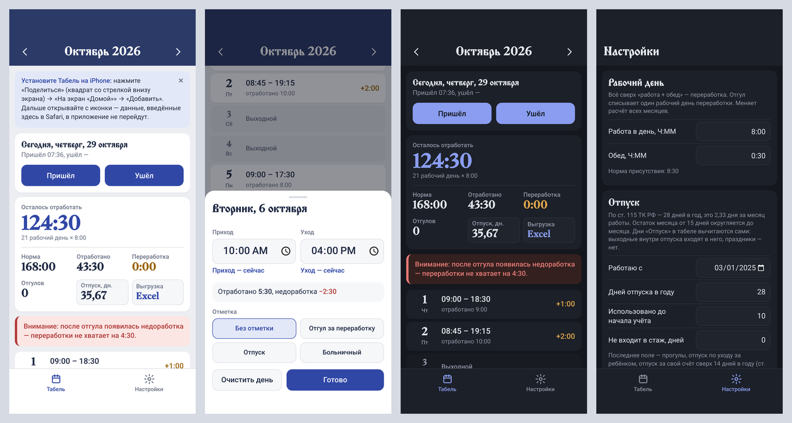
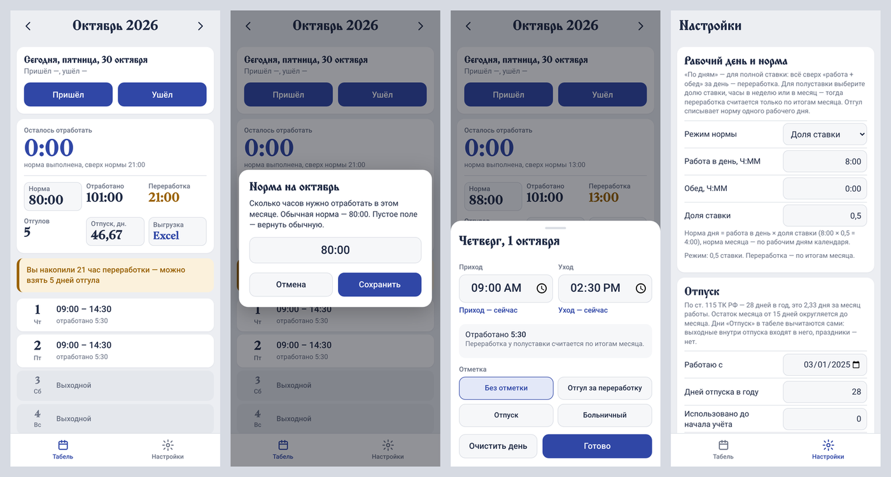

# WorkingTimeTable — табель учёта рабочего времени

**Отмечаете приход и уход, а табель сам считает отработанное время, переработку, остаток до нормы, отгулы и отпуск.**
Работает на iPhone, Android и компьютере, без регистрации и без интернета. Данные хранятся только у вас.

👉 **Открыть приложение:** https://ВАШ-ЛОГИН.github.io/tabel/

---

## Зачем он нужен

Чтобы переработки не копились незаметно. Табель в любой момент показывает:

* сколько уже отработано в этом месяце и сколько осталось до нормы;
* сколько накопилось переработки и сколько дней отгула за неё можно взять;
* сколько дней отпуска положено на сегодня.

Когда переработка дотягивает до целого рабочего дня, табель один раз показывает уведомление
«Вы накопили 8 часов переработки — можно взять 1 день отгула», и над табелем остаётся плашка.

## Что умеет

**Учёт времени**
* Кнопки **«Пришёл»** и **«Ушёл»** ставят текущее время, его можно и ввести вручную за любой день.
* Отметки дней: **отгул за переработку**, **отпуск**, **больничный**.
* Неверное время (уход раньше прихода, 25:70 и т. п.) не сохраняется, появляется понятная подсказка.

**Нормы и календарь**
* Производственный календарь РФ на **2026 и 2027 годы** уже встроен: праздники и переносы по постановлениям Правительства. Свои праздники и рабочие субботы можно добавить.
* Длительность рабочего дня и обеда настраивается (по умолчанию 8:00 + 0:30).
* **Полная ставка:** переработка и недоработка считаются за каждый день, недоработка вычитается из переработок месяца.
* **Полуставка:** норма задаётся долей ставки, часами в неделю или часами в месяц (для отдельного месяца норму можно поменять). Переработка считается по итогам месяца.

**Отпуск по ТК РФ**
* 28 дней в год, то есть **2,33 дня за месяц работы** (ст. 115), с округлением стажа по правилу «от 15 дней — целый месяц».
* Дни «Отпуск» в табеле вычитаются сами: выходные внутри отпуска входят в него, праздники не входят (ст. 120).
* Учитываются периоды, которые не входят в отпускной стаж (ст. 121).

**Отчёты и данные**
* Выгрузка месяца в **Excel**: та же таблица и итоги, на компьютере — с живыми формулами.
* **Синхронизация телефона и ПК** через файл: по каждому дню остаётся более поздняя правка.
* Резервная копия одним файлом, светлая и тёмная тема.

## Правила расчёта

| | Полная ставка | Полуставка |
|---|---|---|
| Отработано за день | уход − приход − обед | уход − приход − обед |
| Норма месяца | рабочие дни × 8:00 | рабочие дни × норма дня (0,5 ставки → 4:00) или своё число часов |
| Переработка | всё сверх 8:30 на работе за каждый день, минус недоработки | всё, что отработано сверх нормы месяца |
| Отгул | списывает 8:00 переработки | списывает норму одного рабочего дня |
| Отпуск, больничный | уменьшают норму месяца | уменьшают норму месяца |

Переработки **не переносятся** на следующий месяц, каждый месяц считается с нуля.

## Установка

**iPhone.** Откройте ссылку выше **в Safari** → «Поделиться» → **«На экран „Домой“»** → «Добавить».
Дальше запускайте табель с иконки: он откроется на весь экран и будет работать без интернета.

**Android.** Установите файл `Tabel.apk` (попросите его у автора) или откройте ссылку в Chrome → меню ⋮ → «Установить приложение».

**Windows и Mac.** Есть программа для компьютера с такими же расчётами. Она собирается в один файл
`Tabel.exe` (Windows) или `Tabel.app` (Mac), инструкция приложена к ней.

## Конфиденциальность и безопасность

* **Ваши записи никуда не отправляются.** Они хранятся только на вашем устройстве, ни у автора, ни у GitHub их нет.
* Сайт не загружает ничего со сторонних ресурсов: ни счётчиков, ни рекламы, ни внешних скриптов. Это закреплено политикой безопасности (CSP).
* Загружаемые файлы проверяются, испорченный или чужой файл не ломает приложение.
* Чтобы не потерять данные, раз в месяц сохраняйте файл в «Настройки» → «Данные и синхронизация с ПК». Данные пропадут, если удалить приложение или очистить данные Safari.

## Устройство проекта

Обычный статический сайт без сборщиков и зависимостей: HTML, CSS и JavaScript.

| Файл | Что делает |
|---|---|
| `index.html`, `app.css`, `pwa.css` | интерфейс |
| `app.js` | логика экрана |
| `calc.js` | расчёты: время, нормы, переработки, отгулы, отпуск, календарь РФ |
| `sync.js` | проверка файлов и синхронизация с программой для ПК |
| `xlsx.js` | выгрузка в Excel без сторонних библиотек |
| `sw.js`, `sw-register.js` | работа без интернета |
| `manifest.webmanifest`, `icons/` | установка на экран «Домой» |
| `fonts/` | шрифты заголовков с кириллицей |

Расчёты совпадают с программой для компьютера. Это проверено автоматической сверкой на ≈2000
случайных сценариях во всех режимах нормы и на 400 парах файлов синхронизации.

## Шрифты и лицензии

Шрифты Monomakh и Shafarik (Slavonic Computing Initiative), Ruslan Display и Old Standard TT (Google Fonts)
распространяются по лицензии **SIL Open Font License 1.1**. Её тексты лежат в `fonts/licenses`.
